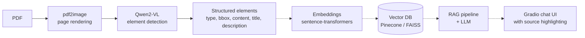

# DocuChat

**A layout-aware, multimodal RAG assistant for asking questions about PDF documents.**

DocuChat reads a PDF the way a person does: page by page, looking at the layout. A vision-language model (Qwen2-VL) detects titles, paragraphs, tables, lists and images, extracts their content, and records where each element sits on the page. That structured output is designed to feed a vector database and an LLM, so answers can point back to the exact region of the source document.

<!-- TODO: add a screenshot or a short GIF of the demo here -->

## Status

| Module | Description | Status |
|---|---|---|
| `pdf_processing` | Qwen2-VL element detection, bounding boxes, OCR, titles and descriptions, caching, visualization | Implemented |
| `vector_db` | Embeddings and indexing (Pinecone, with FAISS for local testing) | Planned |
| `llm` | Local LLM via `llama-cpp-python` (Hermes 2 Pro), RAG pipeline, conversation memory | Planned |
| `ui` | Gradio chat interface with a PDF viewer | Planned |

<!-- TODO: update this table to match what docuchat.ipynb actually implements end to end -->

## How it works



Solid arrows are implemented. Dashed arrows are planned.

## Features

- **Visual PDF analysis** with Qwen2-VL (`Qwen/Qwen2-VL-2B-Instruct` by default)
- **Element detection** for paragraphs, tables, images, titles and lists
- **Normalized bounding boxes** (coordinates in the 0 to 1 range), independent of page resolution
- **Content extraction** with generated titles and short descriptions per element
- **Caching** so a PDF is only processed once
- **Visualization** helpers that draw bounding boxes on page images
- **Filtering and merging** of elements by area and overlap (IoU)
- **JSON export** of results and processing statistics

## Getting started

### Prerequisites

- Python 3.10 or newer
- [Poppler](https://poppler.freedesktop.org/), required by `pdf2image`
  - Ubuntu/Debian: `sudo apt-get install poppler-utils`
  - macOS: `brew install poppler`
  - Windows: download a build from [poppler-windows](https://github.com/oschwartz10612/poppler-windows) and add its `bin` folder to your `PATH`
- A GPU is recommended. The 2B model needs about 4 GB of RAM and takes roughly 3 to 10 seconds per page depending on hardware.

### Installation

```bash
git clone https://github.com/beyzanurulu/DocuChat.git
cd DocuChat
pip install -r requirements.txt
```

### Run the demo

```bash
python demo_pdf_processing.py
```

## Usage

```python
from src.pdf_processing.extractor import DocumentExtractor

extractor = DocumentExtractor(cache_dir="cache")
result = extractor.extract_pdf("sample.pdf")

print(f"Pages: {result.total_pages}")
print(f"Elements: {result.get_total_elements()}")
print(extractor.get_processing_stats(result))

extractor.export_to_json(result, "output.json")
```

### Data model

Each detected element is stored in this form:

```json
{
  "element_id": "page1_elem0_abc123",
  "page_number": 1,
  "element_type": "paragraph",
  "bbox": { "x1": 0.1, "y1": 0.2, "x2": 0.9, "y2": 0.8 },
  "content": "Text extracted from the region",
  "title": "Generated title",
  "description": "Generated description",
  "confidence": 0.85
}
```

`element_type` is one of `paragraph`, `table`, `image`, `title` or `list`.

### Visualizing and filtering

```python
from PIL import Image
from src.pdf_processing.bbox_utils import BoundingBoxUtils

image = Image.open("page1.png")
elements = result.pages[0].elements

# Draw boxes on the page image
BoundingBoxUtils.visualize_bboxes(image, elements, "output.png")

# Drop very small or very large regions, then merge overlapping boxes
elements = BoundingBoxUtils.filter_elements_by_area(elements, min_area=0.001, max_area=0.8)
elements = BoundingBoxUtils.merge_overlapping_boxes(elements, iou_threshold=0.3)
```

## Project structure

```
docuchat/
├── src/
│   ├── pdf_processing/   # Qwen2-VL processor, extractor, bbox utilities
│   ├── vector_db/        # Embeddings, Pinecone client, indexing   (planned)
│   ├── llm/              # LLM client, RAG pipeline, memory        (planned)
│   ├── ui/               # Gradio app, PDF viewer, chat view       (planned)
│   ├── models/           # Pydantic data models
│   └── utils/            # Config and logging
├── tests/
├── docuchat.ipynb        # End-to-end notebook
├── demo_pdf_processing.py
└── requirements.txt
```

## Tests

```bash
pytest tests/ -v
```
